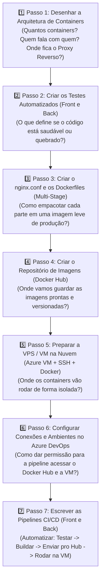
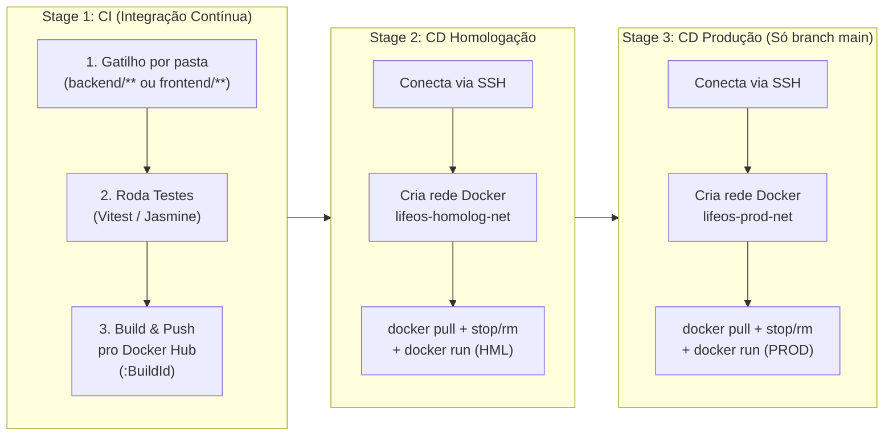

# 🧭 Guia Passo a Passo (Visão Macro): Como Implementar DevOps & CI/CD do Zero em Qualquer Projeto

Este documento é o seu **mapa mental e roteiro lógico de engenharia DevOps**. O objetivo aqui **não é decorar comandos soltos**, mas entender **a ordem exata de raciocínio (do Passo 1 ao Passo 7)** para pegar qualquer aplicação do zero e colocá-la em produção de forma profissional, mesmo sem ajuda de IA.

---

## 🎯 Visão Geral: A Linha de Montagem (Ordem Lógica)

Quando você vai estruturar o DevOps de um projeto do zero, você **nunca começa pela pipeline**. A pipeline é apenas o robô que automatiza o que já existe. Por isso, a ordem lógica obrigatória é:

---

## 🧱 Passo 1: Desenhar a Arquitetura dos Containers (Antes de escrever código)

**Como pensar:** *"Quais são as peças do meu sistema e como elas se conversam?"*
Em qualquer sistema web moderno, você aplica a regra de **1 responsabilidade por container**:

1. **Container 1 (Frontend + Proxy Reverso Nginx):**
   * O navegador do usuário **só conversa com este container** (na porta `80` em Produção ou `8080` em Homologação).
   * Se o usuário pedir uma tela (`/login`, `/dashboard`), o Nginx entrega os arquivos do Frontend (Angular/React/Vue).
   * Se o Frontend pedir dados (`/api/...`), o Nginx funciona como **Proxy Reverso** e encaminha o pedido internamente para o Container 2.
2. **Container 2 (Backend / API):**
   * Roda a regra de negócio (NestJS / Node / Python / Java) na porta interna (ex: `3000`).
   * **Não fica exposto na internet**; só aceita chamadas vindas do Nginx pela rede interna do Docker.
3. **Container 3 (Banco de Dados):**
   * Roda o banco (PostgreSQL / MySQL) na porta interna (`5432`) conectado a um **Volume Persistente** no disco da VM (para que os dados nunca sumam quando o container for atualizado).

---

## 🧪 Passo 2: Implementar os Testes Unitários (A Trava de Segurança)

**Por que vem antes da pipeline?**
Se você criar uma pipeline sem testes, qualquer código com bug que alguém der `git push` vai direto para produção e derruba o site.

**O que fazer em cada projeto:**
1. **No Backend:** criar testes unitários para os serviços principais (ex: Autenticação, Finanças, Regras de Negócio) garantindo que `npm test` retorne verde (`PASS`).
2. **No Frontend:** criar testes para os componentes e serviços críticos e garantir que eles rodem em **modo Headless** (sem precisar abrir janela gráfica do navegador, ex: `ChromeHeadless`), pois o servidor da pipeline não tem tela.

---

## 📦 Passo 3: Criar o `nginx.conf` e os `Dockerfile` (Empacotamento)

**Como pensar:** *"Como eu transformo o meu código em uma imagem pronta para rodar em qualquer servidor, sem precisar instalar Node ou compiladores na VPS?"*

1. **Criar o `frontend/nginx.conf`:**
   * Configurar o bloco `location /` com `try_files $uri $uri/ /index.html;` (para que rotas de SPA não deem erro 404 ao atualizar a página).
   * Configurar o bloco `location /api/` com `proxy_pass http://backend:3000/;` (apontando para o nome do container do backend na rede Docker).
2. **Criar o `frontend/Dockerfile` (Multi-Stage Build):**
   * **Etapa 1 (`builder`):** usa uma imagem Node, instala pacotes e roda `npm run build` para gerar a pasta `dist` (HTML/CSS/JS minificados).
   * **Etapa 2 (`nginx:alpine`):** joga fora o Node e os `node_modules` (que pesam centenas de MBs) e copia **apenas a pasta compilada `dist` e o `nginx.conf`** para dentro do Nginx super leve.
3. **Criar o `backend/Dockerfile` (Multi-Stage Build):**
   * **Etapa 1 (`builder`):** instala tudo, gera o cliente do ORM (Prisma) e compila o TypeScript (`npm run build`).
   * **Etapa 2 (`runner`):** instala apenas dependências de produção (`npm install --omit=dev`), copia o código compilado (`dist`) e define o comando de partida (`CMD`) para sincronizar tabelas e iniciar o servidor (`node dist/main.js`).

> 💡 *Observação sobre o `docker-compose.yml`:* Você pode ter um `docker-compose.yml` para testar os 3 containers na sua máquina local com 1 comando, mas **não o usaremos na VPS de produção**.

---

## 🐳 Passo 4: Preparar o Repositório de Imagens (Docker Hub)

**Por que não compilar a imagem dentro da VPS?**
Porque compilar código (Angular/TypeScript) consome muita memória RAM e CPU. Se você fizer `docker build` dentro de uma VPS de 1 GB ou 2 GB de RAM, o servidor trava e tira o sistema do ar.

**Como funciona na prática:**
1. Você cria sua conta no **Docker Hub** (ex: `joaogabriel199`) e cria **2 repositórios**: `app-pessoal-backend` e `app-pessoal-frontend`.
2. O endereço das suas imagens seguirá sempre o padrão **`usuario/nome-do-repositorio:tag`**:
   * Backend: `joaogabriel199/app-pessoal-backend:<numero-do-build>`
   * Frontend: `joaogabriel199/app-pessoal-frontend:<numero-do-build>`
3. Em **Account Settings → Security → Personal Access Tokens**, você gera um token (`Read, Write, Delete`) para colar na *Service Connection* do Azure DevOps.
3. Assim, quem faz o trabalho pesado de compilar é o servidor gratuito da pipeline (Azure DevOps), e a sua VPS só baixa a imagem pronta e leve (`docker pull`).

---

## ☁️ Passo 5: Preparar a VPS / VM na Nuvem (Azure VM)

Antes de mandar a pipeline fazer deploy na VM, você prepara o terreno na máquina virtual uma única vez:

1. **Instalar o Docker na VM Linux:** instalar apenas o Docker Engine (não precisa instalar Node, nem Angular, nem Postgres direto na VM).
2. **Configurar Memória Swap (se a VM tiver 1 GB ou 2 GB de RAM):** criar um arquivo de Swap de 2 GB no disco para evitar quedas por pico de memória.
3. **Liberar Portas no Firewall da Azure (NSG):**
   * Porta `22` (SSH — para a pipeline conseguir entrar na máquina).
   * Porta `80` (HTTP Produção — para os usuários acessarem o site).
   * Porta `8080` (HTTP Homologação — caso rode homologação na mesma VM).
   * *(As portas `3000` do Back e `5432` do Banco ficam **fechadas** para a internet).*
4. **Gerar Chave SSH:** criar o par de chaves SSH (`ssh-keygen`) e colocar a chave pública no `~/.ssh/authorized_keys` da VM.

---

## 🔐 Passo 6: Configurar o Painel do Azure DevOps (Credenciais e Ambientes)

A pipeline em código YAML não guarda senhas por segurança. Então, no painel web do **Azure DevOps**, você configura 3 coisas:

1. **Service Connections (*Project Settings → Service connections*):**
   * **`dockerhub-connection`:** conecta sua conta `joaogabriel199` do Docker Hub para permitir que a pipeline faça `docker push`.
   * **`azure-vm-homolog-ssh` e `azure-vm-prod-ssh`:** guarda o IP da sua VM, o usuário Linux e a chave privada SSH para a pipeline conseguir entrar na VM.
2. **Environments (*Pipelines → Environments*):**
   * Criar o ambiente **`homologacao`** e o ambiente **`producao`**.
   * No ambiente `producao`, você pode ativar **Approvals and Checks** para exigir um clique seu de aprovação antes de atualizar a produção.
3. **Variáveis Secretas (*Pipelines → Library / Variables*):**
   * Cadastrar as variáveis `POSTGRES_USER_PROD`, `POSTGRES_PASSWORD_PROD`, `JWT_SECRET_PROD` (e as de `_HML`).

---

## ⚙️ Passo 7: Escrever as Duas Pipelines CI/CD (`azure-pipelines.yml`)

Com todas as peças prontas, você escreve as duas pipelines independentes ([backend/azure-pipelines.yml](file:///c:/Users/Joao%20Gabriel/Desktop/APP_PESSOAL/APP_PESSOAL/backend/azure-pipelines.yml) e [frontend/azure-pipelines.yml](file:///c:/Users/Joao%20Gabriel/Desktop/APP_PESSOAL/APP_PESSOAL/frontend/azure-pipelines.yml)):

1. **Por que duas pipelines separadas com filtro de caminho (`paths: include`)?**
   * Se você mudar apenas uma cor de botão no `frontend/`, **só a pipeline do Frontend roda** e atualiza apenas o Container 1 (o Backend e o Banco nem piscam).
   * Se você mudar apenas uma regra no `backend/`, **só a pipeline do Backend roda** e atualiza apenas o Container 2.
2. **Como cada Stage de CD (Homologação e Produção) funciona na prática:**
   * A tarefa `SSH@0` entra na VM e garante que a rede isolada existe (`docker network create`).
   * Na pipeline do Backend, ela verifica se o container do banco (`lifeos-postgres`) já está rodando; se não estiver, sobe ele com volume persistente.
   * Em seguida, faz `docker pull joaogabriel199/lifeos-...:$(Build.BuildId)`, para e remove o container antigo (`docker stop` / `docker rm`) e sobe o novo (`docker run -d --restart always --network ...`) usando exatamente a versão testada naquele build.

---

## ✅ Checklist Final: Nossa Arquitetura Já Está Fechada?

| Etapa | Status no Código do Repositório | O que falta você fazer no Painel da Nuvem (Azure / Docker Hub) |
| :--- | :--- | :--- |
| **1. Arquitetura de 3 Containers** | ✅ 100% Pronta | Nada — já desenhada e isolada por rede Docker. |
| **2. Testes Unitários (Front e Back)** | ✅ 100% Prontos (17 testes passando) | Nada — já rodam automaticamente nas pipelines. |
| **3. `Dockerfile` (Front/Back) + `nginx.conf`** | ✅ 100% Prontos | Nada — Multi-stage build e Proxy Reverso configurados. |
| **4. Usuário Docker Hub nas Pipelines** | ✅ Configurado (`joaogabriel199`) | Apenas ter a conta criada em [hub.docker.com](https://hub.docker.com). |
| **5. VM da Azure (`Standard B2ts v2`)** | ⚠️ Ação na VM | Instalar Docker na VM, ativar 2 GB de Swap e abrir a porta 80 no NSG. |
| **6. Service Connections no Azure DevOps** | ⚠️ Ação no Painel Azure DevOps | Cadastrar `dockerhub-connection`, `azure-vm-homolog-ssh`, `azure-vm-prod-ssh` e as variáveis de senha. |
| **7. Pipelines YAML (HML e PROD)** | ✅ 100% Prontas no GitHub | Apenas importar os 2 arquivos `.yml` no menu *Pipelines* do Azure DevOps. |
