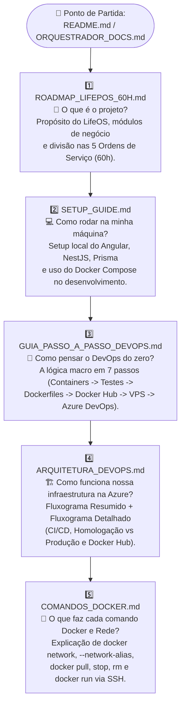

# 🧭 Orquestrador de Documentação — LifeOS (`APP_PESSOAL`)

Bem-vindo ao **Índice Mestre (Orquestrador)** do projeto **LifeOS**. Este arquivo organiza todos os documentos `.md` e configurações técnicas do repositório na **ordem exata de leitura** para você entender desde o propósito do sistema até a infraestrutura DevOps em produção na Azure.

---

## 🗺️ Mapa de Leitura (Qual `.md` ler primeiro?)

---

## 📚 1. Trilha Principal de Documentos (`.md`)

| Ordem | Documento | Sobre o que ele fala? | Quando consultar? |
| :---: | :--- | :--- | :--- |
| **1º** | [**ROADMAP_LIFEPOS_60H.md**](file:///c:/Users/Joao%20Gabriel/Desktop/APP_PESSOAL/APP_PESSOAL/ROADMAP_LIFEPOS_60H.md) | Planejamento geral de 60h, stack tecnológica (Angular 19 + NestJS + PostgreSQL) e escopo das 5 Ordens de Serviço (OS 01 a OS 05). | Para entender **o propósito da aplicação** e o que cada módulo faz. |
| **2º** | [**SETUP_GUIDE.md**](file:///c:/Users/Joao%20Gabriel/Desktop/APP_PESSOAL/APP_PESSOAL/SETUP_GUIDE.md) | Passo a passo de instalação local, configuração do `.env`, migrations do Prisma e como subir o ambiente de desenvolvimento com `docker compose up --build`. | Quando for **programar localmente** na sua máquina. |
| **3º** | [**GUIA_PASSO_A_PASSO_DEVOPS.md**](file:///c:/Users/Joao%20Gabriel/Desktop/APP_PESSOAL/APP_PESSOAL/GUIA_PASSO_A_PASSO_DEVOPS.md) | Roteiro mental em **7 passos lógicos** explicando por onde começar e como implementar essa mesma arquitetura DevOps do zero em qualquer outro projeto sem IA. | Quando quiser **entender a lógica de construção** ou replicar em outro projeto. |
| **4º** | [**ARQUITETURA_DEVOPS.md**](file:///c:/Users/Joao%20Gabriel/Desktop/APP_PESSOAL/APP_PESSOAL/ARQUITETURA_DEVOPS.md) | Visão arquitetural com **Fluxograma Resumido**, **Fluxograma Detalhado**, separação de Homologação (`:8080`) e Produção (`:80`) e integração com o Docker Hub (`joaogabriel199`). | Quando quiser **visualizar o desenho completo** da infraestrutura CI/CD. |
| **5º** | [**COMANDOS_DOCKER.md**](file:///c:/Users/Joao%20Gabriel/Desktop/APP_PESSOAL/APP_PESSOAL/COMANDOS_DOCKER.md) | Explicação detalhada das **redes virtuais do Docker** (`lifeos-prod-net` e `lifeos-homolog-net`), apelidos de DNS (`--network-alias`) e todos os comandos executados via SSH na VPS. | Quando tiver dúvida sobre **como os 3 containers conversam** ou sobre um comando Docker específico. |

---

## ⚙️ 2. Acesso Rápido aos Arquivos de Infraestrutura e Testes

Caso você queira ir direto para o código citado nos documentos acima:

### Pipelines CI/CD (Azure DevOps)
* **Pipeline do Backend + Banco:** [backend/azure-pipelines.yml](file:///c:/Users/Joao%20Gabriel/Desktop/APP_PESSOAL/APP_PESSOAL/backend/azure-pipelines.yml)
* **Pipeline do Frontend + Nginx:** [frontend/azure-pipelines.yml](file:///c:/Users/Joao%20Gabriel/Desktop/APP_PESSOAL/APP_PESSOAL/frontend/azure-pipelines.yml)

### Containers & Proxy Reverso
* **Dockerfile do Backend (NestJS + Prisma):** [backend/Dockerfile](file:///c:/Users/Joao%20Gabriel/Desktop/APP_PESSOAL/APP_PESSOAL/backend/Dockerfile)
* **Dockerfile do Frontend (Angular + Nginx):** [frontend/Dockerfile](file:///c:/Users/Joao%20Gabriel/Desktop/APP_PESSOAL/APP_PESSOAL/frontend/Dockerfile)
* **Configuração do Proxy Reverso Nginx:** [frontend/nginx.conf](file:///c:/Users/Joao%20Gabriel/Desktop/APP_PESSOAL/APP_PESSOAL/frontend/nginx.conf)
* **Orquestração Local (Apenas Desenvolvimento):** [docker-compose.yml](file:///c:/Users/Joao%20Gabriel/Desktop/APP_PESSOAL/APP_PESSOAL/docker-compose.yml)

### Suítes de Testes Unitários
* **Backend (Vitest — 4 suítes / 9 testes):**
  * [auth.service.spec.ts](file:///c:/Users/Joao%20Gabriel/Desktop/APP_PESSOAL/APP_PESSOAL/backend/src/auth/auth.service.spec.ts)
  * [financas.service.spec.ts](file:///c:/Users/Joao%20Gabriel/Desktop/APP_PESSOAL/APP_PESSOAL/backend/src/financas/financas.service.spec.ts)
  * [produtividade.service.spec.ts](file:///c:/Users/Joao%20Gabriel/Desktop/APP_PESSOAL/APP_PESSOAL/backend/src/produtividade/produtividade.service.spec.ts)
  * [app.controller.spec.ts](file:///c:/Users/Joao%20Gabriel/Desktop/APP_PESSOAL/APP_PESSOAL/backend/src/app.controller.spec.ts)
* **Frontend (Karma/Jasmine — 3 suítes / 8 testes):**
  * [app.component.spec.ts](file:///c:/Users/Joao%20Gabriel/Desktop/APP_PESSOAL/APP_PESSOAL/frontend/src/app/app.component.spec.ts)
  * [auth.service.spec.ts](file:///c:/Users/Joao%20Gabriel/Desktop/APP_PESSOAL/APP_PESSOAL/frontend/src/app/core/services/auth.service.spec.ts)
  * [financas.service.spec.ts](file:///c:/Users/Joao%20Gabriel/Desktop/APP_PESSOAL/APP_PESSOAL/frontend/src/app/features/financas/services/financas.service.spec.ts)

### Automação de Documentação (Skill)
* **Skill de Atualização Contínua:** [.agents/skills/devops-doc-updater/SKILL.md](file:///c:/Users/Joao%20Gabriel/Desktop/APP_PESSOAL/APP_PESSOAL/.agents/skills/devops-doc-updater/SKILL.md)
