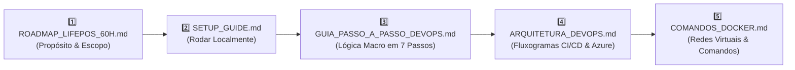

# 📱 LifeOS (`APP_PESSOAL`) — Sistema Pessoal de Alta Performance

Painel fullstack unificado para gestão de **Finanças (Envelopes, Gastos e Investimentos)**, **Produtividade (Hábitos Diários)**, **Controle de Erros & Penalidades**, **Saúde & Fitness** e **Diário Pessoal**.

---

## 🧭 Orquestrador de Documentação (Por onde começar?)

Para navegar por toda a documentação de produto e engenharia DevOps deste projeto, siga a trilha abaixo (também disponível em [**ORQUESTRADOR_DOCS.md**](file:///c:/Users/Joao%20Gabriel/Desktop/APP_PESSOAL/APP_PESSOAL/ORQUESTRADOR_DOCS.md)):

| Ordem | Arquivo `.md` | Resumo do Conteúdo |
| :---: | :--- | :--- |
| **1º** | [**ROADMAP_LIFEPOS_60H.md**](file:///c:/Users/Joao%20Gabriel/Desktop/APP_PESSOAL/APP_PESSOAL/ROADMAP_LIFEPOS_60H.md) | Propósito do sistema, módulos de negócio e planejamento das 5 Ordens de Serviço (60h). |
| **2º** | [**SETUP_GUIDE.md**](file:///c:/Users/Joao%20Gabriel/Desktop/APP_PESSOAL/APP_PESSOAL/SETUP_GUIDE.md) | Como rodar o projeto em **ambiente de desenvolvimento** (com Node/Angular ou Docker Compose). |
| **3º** | [**GUIA_PASSO_A_PASSO_DEVOPS.md**](file:///c:/Users/Joao%20Gabriel/Desktop/APP_PESSOAL/APP_PESSOAL/GUIA_PASSO_A_PASSO_DEVOPS.md) | **Roteiro lógico em 7 passos** de como estruturar Containers, Testes, Docker Hub, VPS e Pipelines do zero em qualquer projeto. |
| **4º** | [**ARQUITETURA_DEVOPS.md**](file:///c:/Users/Joao%20Gabriel/Desktop/APP_PESSOAL/APP_PESSOAL/ARQUITETURA_DEVOPS.md) | **Fluxograma Resumido + Fluxograma Detalhado** das 2 pipelines no Azure DevOps (Homologação e Produção) e publicação no Docker Hub (`joaogabriel199`). |
| **5º** | [**COMANDOS_DOCKER.md**](file:///c:/Users/Joao%20Gabriel/Desktop/APP_PESSOAL/APP_PESSOAL/COMANDOS_DOCKER.md) | Explicação de todos os **comandos Docker e redes virtuais** (`docker network create`, `--network`, `--network-alias`, `docker pull` e `docker run`). |
