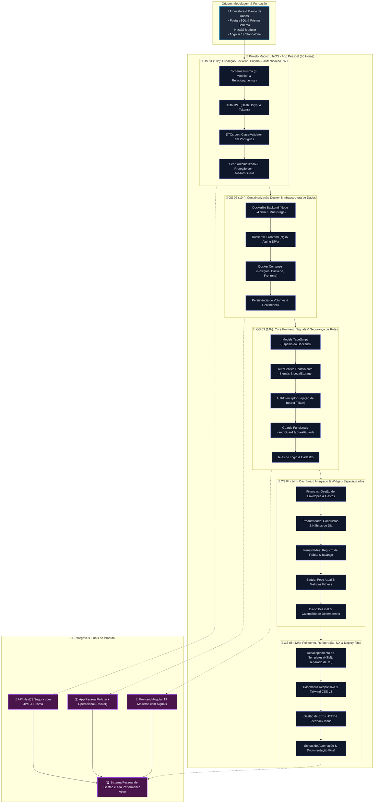

# 📱 Planejamento do Projeto: LifeOS - Sistema Pessoal de Alta Performance (60h)

## 📌 Contexto & Perfil
* **Aplicação:** LifeOS — Painel Pessoal Unificado (Finanças, Saúde/Fitness, Produtividade, Registro de Erros & Diários).
* **Stack Tecnológica:**
  * **Backend:** NestJS + Prisma ORM + PostgreSQL + JWT Authentication + Class Validator.
  * **Frontend:** Angular 19 (Standalone Components, Signals Reativos, Guards Funcionais, Interceptors) + Tailwind CSS v3.4.
  * **Infraestrutura:** Docker & Docker Compose (Multi-stage builds, isolamento de rede, persistência em volumes).
* **Modelo Operacional:** Divisão em **Ordens de Serviço (OSs)** com banco de horas fechado (Total: **60 Horas**).
* **Documentação de Referência Metodológica:**
  * [ROADMAP_DEVSECOPS_60H.md](file:///c:/Users/Joao%20Gabriel/Desktop/CYBERSEGURANCA/CyberSeguranca/ROADMAP_DEVSECOPS_60H.md) (Modelo de arquitetura de projeto em 60h dividido em OSs).
  * [fluxograma_frontend.md](file:///C:/Users/Joao%20Gabriel/.gemini/antigravity/brain/8eac50aa-e0f4-4f0a-875e-a722aaa6e5f9/fluxograma_frontend.md) (Mapeamento de fluxo de navegação, guards, interceptors e signals).
  * [SKILL.md (sync-ecosystem)](file:///C:/Users/Joao%20Gabriel/.gemini/config/skills/sync-ecosystem/SKILL.md) (Regras de apontamento integrado Clockify + Trello + Google Calendar).

---

## 🗺️ Visão Geral da Arquitetura & Grafo do Projeto

---

## 📋 Detalhamento das Ordens de Serviço (OSs)

### OS 01: Fundação Backend, Prisma & Autenticação JWT (10 Horas)
* **Status:** ✅ Concluído
* **Objetivo:** Estruturar toda a camada de dados do PostgreSQL, serviços RESTful modulares no NestJS e autenticação baseada em JWT.
* **Escopo:**
  * Modelagem relacional no Prisma: `Usuario`, `Envelope`, `Gasto`, `Tarefa`, `Diario`, `Falha`, `CategoriaFalha`, `Meta_Fitness`, `HistoricoFitness`.
  * Módulo de Autenticação com NestJS Passport e JWT (hashing de senha via Bcrypt).
  * Criação de DTOs com `class-validator` e mensagens amigáveis em português.
  * Proteção global de rotas com `JwtAuthGuard` (exceto rota pública de cadastro).
  * Script de seed automatizado (`seed.js`) populando dados de demonstração.
* **Entregável:** Backend NestJS operando com banco PostgreSQL, gerando tokens JWT válidos e validando entradas.

---

### OS 02: Containerização Docker & Infraestrutura de Dados (10 Horas)
* **Status:** ✅ Concluído
* **Objetivo:** Empacotar a solução em containers Docker permitindo subir toda a stack (PostgreSQL + NestJS + Nginx/Angular) com um único comando.
* **Escopo:**
  * `Dockerfile` do backend com compilação TypeScript, Prisma client e execução enxuta em Node 24.
  * `Dockerfile` do frontend em multi-stage build (compilação Angular + servidor Nginx Alpine).
  * `nginx.conf` configurado para Single Page Application (SPA com `try_files` para roteamento limpo).
  * `docker-compose.yml` orquestrando as 3 aplicações, volumes persistentes e healthchecks de banco de dados.
  * Resolução de conflitos de portas locais (frontend rodando na porta 4200, backend na 3000, Postgres na 5432).
* **Entregável:** Ambiente completo rodando via `docker compose up --build`.

---

### OS 03: Core Frontend, Signals & Segurança de Rotas (14 Horas)
* **Status:** ✅ Concluído
* **Objetivo:** Construir a fundação arquitetural do frontend Angular 19 utilizando Signals, interceptação de requisições e proteção de navegação.
* **Escopo:**
  * Camada de contratos: `core/models/app.models.ts` refletindo fielmente os dados do backend.
  * `AuthService` reativo com `tokenSignal` e `isLoggedIn` computado sincronizado com `localStorage`.
  * `authInterceptor` funcional injetando o cabeçalho `Authorization: Bearer <token>` em todas as requisições HTTP.
  * Implementação de `authGuard` (bloqueio de acesso a não autenticados) e `guestGuard` (redirecionamento de autenticados).
  * Telas de Login e Cadastro funcionais integradas à API.
* **Entregável:** Fluxo completo de autenticação e proteção de rotas no frontend funcionando de ponta a ponta.

---

### OS 04: Dashboard Integrado & Widgets Especializados (14 Horas)
* **Status:** 🚀 Em Andamento / Concluído
* **Objetivo:** Implementar os componentes de painel de controle conectados em tempo real com as APIs do backend.
* **Escopo:**
  * Widget de Finanças: visualização de envelopes orçamentários, barras de consumo e status de estouro.
  * Widget de Hábitos e Produtividade: lista de tarefas diárias com toggle de conclusão e cálculo de pontuação.
  * Widget de Erros e Penalidades: listagem de falhas cometidas com impacto percentual no balanço diário.
  * Widget de Balanço Diário: cálculo reativo da pontuação do dia (Hábitos - Falhas).
  * Widget de Diário Pessoal: escrita e persistência de notas diárias no PostgreSQL.
  * Widget de Calendário de Desempenho: mapa visual de consistência mensal com dias verdes/amarelos/vermelhos.
* **Entregável:** Dashboard interativo consumindo e manipulando dados reais do PostgreSQL via Signals.

---

### OS 05: Desacoplamento, UX, Refatoração & Entrega Final (12 Horas)
* **Status:** 🚀 Em Andamento
* **Objetivo:** Refatoração de arquitetura de código, separação de responsabilidades (HTML vs TS), estilização responsiva e fechamento de documentação.
* **Escopo:**
  * Desacoplamento completo de templates: extração de todos os 14 templates inline para arquivos `.component.html` independentes.
  * Organização modular (`core/`, `shared/`, `features/`).
  * Estilização moderna com Tailwind CSS v3.4 (paleta limpa, componentes minimalistas).
  * Ajustes de navegação na Sidebar e Header com saudações dinâmicas pelo nome do usuário.
  * Documentação arquitetural completa, fluxograma e alinhamento com ecossistema de gestão (Clockify, Trello e Google Calendar).
* **Entregável:** Aplicação final polida, código limpo desacoplado e documentado.

---

## 📚 Documentações Técnicas Oficiais & Referências de Apoio

A arquitetura e os padrões deste projeto foram desenhados com base nas seguintes fontes e documentações oficiais:

### 1. Backend & Banco de Dados
* **NestJS Documentation:** [docs.nestjs.com](https://docs.nestjs.com/)
  * *Módulos, Controllers, Services e Injeção de Dependências.*
  * *NestJS Authentication & Passport JWT:* [docs.nestjs.com/security/authentication](https://docs.nestjs.com/security/authentication)
  * *Validation Pipes & Class-Validator:* [docs.nestjs.com/techniques/validation](https://docs.nestjs.com/techniques/validation)
* **Prisma ORM Documentation:** [www.prisma.io/docs](https://www.prisma.io/docs)
  * *Modelagem Relacional de Schemas & Migrations com PostgreSQL.*
  * *Prisma Client e Seeds Automatizados.*
* **PostgreSQL Official Documentation:** [www.postgresql.org/docs](https://www.postgresql.org/docs/)

### 2. Frontend & Reatividade Moderna
* **Angular Documentation (v19+):** [angular.dev](https://angular.dev/)
  * *Standalone Components & Modern Project Structure:* [angular.dev/reference/migrations/standalone](https://angular.dev/reference/migrations/standalone)
  * *Angular Signals Guide (`signal`, `computed`, `effect`):* [angular.dev/guide/signals](https://angular.dev/guide/signals)
  * *Functional Router Guards (`CanActivateFn`):* [angular.dev/api/router/CanActivateFn](https://angular.dev/api/router/CanActivateFn)
  * *Functional HTTP Interceptors (`HttpInterceptorFn`):* [angular.dev/guide/http/interceptors](https://angular.dev/guide/http/interceptors)
* **Tailwind CSS v3 Documentation:** [v3.tailwindcss.com](https://v3.tailwindcss.com/)
  * *Configuração de Content Scanning para Angular (`./src/**/*.{html,ts}`).*
  * *Utilitários de Flexbox, Grid e Paleta Slate/Emerald/Zinc.*

### 3. Containerização & Infraestrutura
* **Docker Documentation:** [docs.docker.com](https://docs.docker.com/)
  * *Multi-stage builds para Node.js e compilação de assets estáticos.*
  * *Docker Compose v2 Specification (volumes, networks, healthchecks).*
* **Nginx Documentation:** [nginx.org/en/docs](https://nginx.org/en/docs/)
  * *Configuração de Servidor de Produção SPA (`try_files $uri $uri/ /index.html`).*

### 4. Metodologia Interna de Gestão
* **Roadmap DevSecOps 60h:** [`ROADMAP_DEVSECOPS_60H.md`](file:///c:/Users/Joao%20Gabriel/Desktop/CYBERSEGURANCA/CyberSeguranca/ROADMAP_DEVSECOPS_60H.md)
* **Skill de Sincronização do Ecossistema:** [`SKILL.md (sync-ecosystem)`](file:///C:/Users/Joao%20Gabriel/.gemini/config/skills/sync-ecosystem/SKILL.md)
* **Fluxograma e Arquitetura do Frontend:** [`fluxograma_frontend.md`](file:///C:/Users/Joao%20Gabriel/.gemini/antigravity/brain/8eac50aa-e0f4-4f0a-875e-a722aaa6e5f9/fluxograma_frontend.md)
